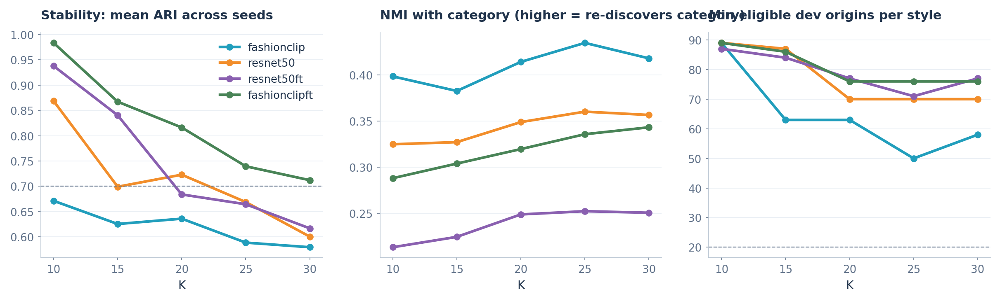

# G2 / RQ1 - So sánh FashionCLIP và ResNet-50

Silhouette và DBI chỉ so trong cùng một encoder. Giữa hai encoder chỉ so ARI, NMI, coverage, kích thước.
`pass_all` = qua gate đăng ký trước (size, stability, coverage). Chọn cuối cùng cần xem contact sheets.

| encoder       |   k |   silhouette |   davies_bouldin |   ari_mean |   ari_sd |   size_min |   size_max |   min_eligible_dev_origins |   nmi_category |   nmi_color |   nmi_fabric | pass_size   | pass_stability   | pass_coverage   | pass_all   |
|:--------------|----:|-------------:|-----------------:|-----------:|---------:|-----------:|-----------:|---------------------------:|---------------:|------------:|-------------:|:------------|:-----------------|:----------------|:-----------|
| fashionclip   |  10 |        0.065 |            3.21  |      0.671 |    0.076 |        160 |        505 |                         89 |          0.399 |       0.109 |        0.321 | True        | False            | True            | False      |
| fashionclip   |  15 |        0.061 |            3.223 |      0.625 |    0.08  |         93 |        392 |                         63 |          0.383 |       0.131 |        0.357 | True        | False            | True            | False      |
| fashionclip   |  20 |        0.065 |            3.041 |      0.636 |    0.062 |         93 |        269 |                         63 |          0.414 |       0.125 |        0.367 | True        | False            | True            | False      |
| fashionclip   |  25 |        0.063 |            2.983 |      0.589 |    0.048 |         81 |        284 |                         50 |          0.435 |       0.121 |        0.394 | True        | False            | True            | False      |
| fashionclip   |  30 |        0.063 |            2.901 |      0.58  |    0.047 |         69 |        181 |                         58 |          0.418 |       0.122 |        0.395 | True        | False            | True            | False      |
| resnet50      |  10 |        0.08  |            2.865 |      0.869 |    0.074 |        135 |        585 |                         89 |          0.325 |       0.067 |        0.266 | True        | True             | True            | True       |
| resnet50      |  15 |        0.069 |            2.843 |      0.699 |    0.073 |        116 |        479 |                         87 |          0.327 |       0.088 |        0.292 | True        | False            | True            | False      |
| resnet50      |  20 |        0.066 |            2.826 |      0.723 |    0.05  |        111 |        286 |                         70 |          0.349 |       0.099 |        0.33  | True        | True             | True            | True       |
| resnet50      |  25 |        0.062 |            2.753 |      0.669 |    0.057 |         71 |        251 |                         70 |          0.36  |       0.113 |        0.336 | True        | False            | True            | False      |
| resnet50      |  30 |        0.06  |            2.871 |      0.601 |    0.039 |         64 |        213 |                         70 |          0.357 |       0.124 |        0.343 | True        | False            | True            | False      |
| resnet50ft    |  10 |        0.099 |            2.393 |      0.938 |    0.019 |        111 |        487 |                         87 |          0.213 |       0.196 |        0.197 | True        | True             | True            | True       |
| resnet50ft    |  15 |        0.094 |            2.393 |      0.84  |    0.058 |        108 |        352 |                         84 |          0.225 |       0.225 |        0.22  | True        | True             | True            | True       |
| resnet50ft    |  20 |        0.085 |            2.531 |      0.684 |    0.048 |        106 |        299 |                         77 |          0.249 |       0.232 |        0.241 | True        | False            | True            | False      |
| resnet50ft    |  25 |        0.086 |            2.479 |      0.665 |    0.053 |         40 |        239 |                         71 |          0.252 |       0.247 |        0.258 | True        | False            | True            | False      |
| resnet50ft    |  30 |        0.076 |            2.484 |      0.617 |    0.04  |         40 |        217 |                         77 |          0.251 |       0.256 |        0.261 | True        | False            | True            | False      |
| fashionclipft |  10 |        0.118 |            2.157 |      0.984 |    0.015 |        214 |        581 |                         89 |          0.288 |       0.28  |        0.21  | True        | True             | True            | True       |
| fashionclipft |  15 |        0.124 |            2.202 |      0.867 |    0.06  |        120 |        455 |                         86 |          0.304 |       0.315 |        0.229 | True        | True             | True            | True       |
| fashionclipft |  20 |        0.111 |            2.349 |      0.816 |    0.051 |         99 |        325 |                         76 |          0.32  |       0.314 |        0.261 | True        | True             | True            | True       |
| fashionclipft |  25 |        0.102 |            2.368 |      0.74  |    0.053 |         68 |        288 |                         76 |          0.336 |       0.319 |        0.278 | True        | True             | True            | True       |
| fashionclipft |  30 |        0.096 |            2.478 |      0.712 |    0.034 |         56 |        203 |                         76 |          0.343 |       0.31  |        0.286 | True        | True             | True            | True       |

