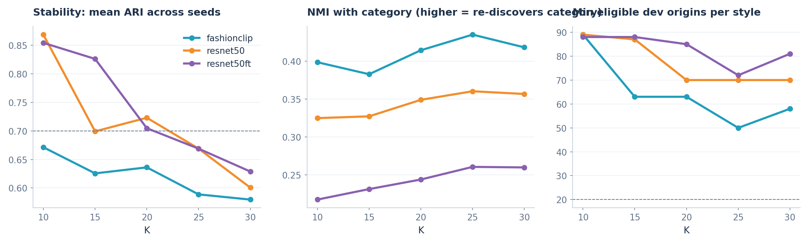

# G2 / RQ1 - So sánh FashionCLIP và ResNet-50

Silhouette và DBI chỉ so trong cùng một encoder. Giữa hai encoder chỉ so ARI, NMI, coverage, kích thước.
`pass_all` = qua gate đăng ký trước (size, stability, coverage). Chọn cuối cùng cần xem contact sheets.

| encoder     |   k |   silhouette |   davies_bouldin |   ari_mean |   ari_sd |   size_min |   size_max |   min_eligible_dev_origins |   nmi_category |   nmi_color |   nmi_fabric | pass_size   | pass_stability   | pass_coverage   | pass_all   |
|:------------|----:|-------------:|-----------------:|-----------:|---------:|-----------:|-----------:|---------------------------:|---------------:|------------:|-------------:|:------------|:-----------------|:----------------|:-----------|
| fashionclip |  10 |        0.065 |            3.21  |      0.671 |    0.076 |        160 |        505 |                         89 |          0.399 |       0.109 |        0.321 | True        | False            | True            | False      |
| fashionclip |  15 |        0.061 |            3.223 |      0.625 |    0.08  |         93 |        392 |                         63 |          0.383 |       0.131 |        0.357 | True        | False            | True            | False      |
| fashionclip |  20 |        0.065 |            3.041 |      0.636 |    0.062 |         93 |        269 |                         63 |          0.414 |       0.125 |        0.367 | True        | False            | True            | False      |
| fashionclip |  25 |        0.063 |            2.983 |      0.589 |    0.048 |         81 |        284 |                         50 |          0.435 |       0.121 |        0.394 | True        | False            | True            | False      |
| fashionclip |  30 |        0.063 |            2.901 |      0.58  |    0.047 |         69 |        181 |                         58 |          0.418 |       0.122 |        0.395 | True        | False            | True            | False      |
| resnet50    |  10 |        0.08  |            2.865 |      0.869 |    0.074 |        135 |        585 |                         89 |          0.325 |       0.067 |        0.266 | True        | True             | True            | True       |
| resnet50    |  15 |        0.069 |            2.843 |      0.699 |    0.073 |        116 |        479 |                         87 |          0.327 |       0.088 |        0.292 | True        | False            | True            | False      |
| resnet50    |  20 |        0.066 |            2.826 |      0.723 |    0.05  |        111 |        286 |                         70 |          0.349 |       0.099 |        0.33  | True        | True             | True            | True       |
| resnet50    |  25 |        0.062 |            2.753 |      0.669 |    0.057 |         71 |        251 |                         70 |          0.36  |       0.113 |        0.336 | True        | False            | True            | False      |
| resnet50    |  30 |        0.06  |            2.871 |      0.601 |    0.039 |         64 |        213 |                         70 |          0.357 |       0.124 |        0.343 | True        | False            | True            | False      |
| resnet50ft  |  10 |        0.095 |            2.333 |      0.854 |    0.141 |        114 |        494 |                         88 |          0.218 |       0.172 |        0.21  | True        | True             | True            | True       |
| resnet50ft  |  15 |        0.095 |            2.496 |      0.826 |    0.066 |        113 |        344 |                         88 |          0.231 |       0.205 |        0.232 | True        | True             | True            | True       |
| resnet50ft  |  20 |        0.095 |            2.5   |      0.705 |    0.047 |         40 |        341 |                         85 |          0.244 |       0.21  |        0.254 | True        | True             | True            | True       |
| resnet50ft  |  25 |        0.086 |            2.427 |      0.669 |    0.043 |         39 |        267 |                         72 |          0.261 |       0.217 |        0.269 | True        | False            | True            | False      |
| resnet50ft  |  30 |        0.08  |            2.463 |      0.629 |    0.036 |         38 |        213 |                         81 |          0.26  |       0.237 |        0.274 | True        | False            | True            | False      |

